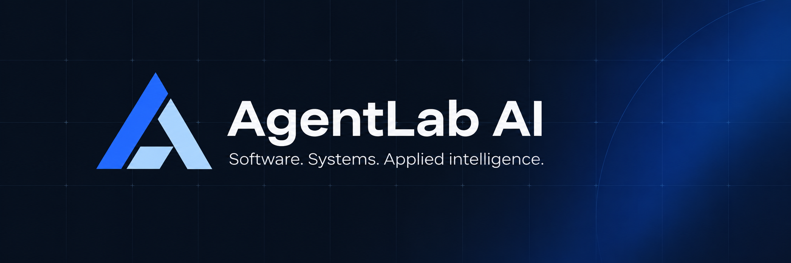

  

## Practical ideas. Carefully engineered.

AgentLab AI develops software, automation, and intelligent systems. We turn experiments into useful tools, with an emphasis on clarity, reliability, and maintainability.

### Areas of focus

| Software | Systems | Applied intelligence |
| :--- | :--- | :--- |
| Purpose-built applications and developer tools. | Automation, integrations, and dependable infrastructure. | Putting AI to work in practical workflows. |

### Open development

Public projects are published here as they become ready to share. Each repository is the home for its documentation, releases, and contribution guidance.

[Explore public repositories →](https://github.com/orgs/AgentLab-AI/repositories?type=public)

---

AgentLab AI · Research & engineering
